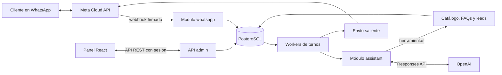
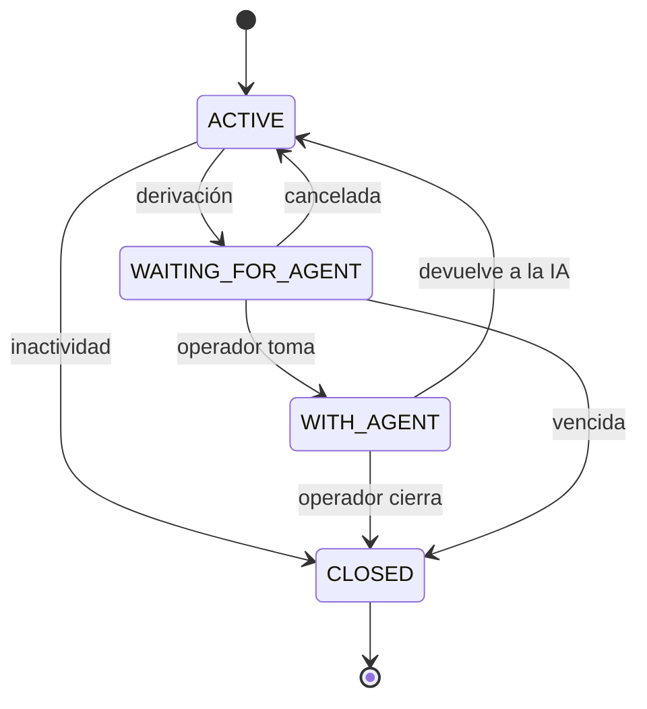

# Etapa 2: Diseño de arquitectura

Estado: borrador para validar. Fecha: 2026-11-10.

## Qué define esta etapa y por qué

Esta etapa fija cómo se reparten las responsabilidades, cómo viaja un mensaje y qué pasa cuando algo falla. No incluye código.

Se relaciona con el resto así: los módulos definen los paquetes (Etapa 4), los flujos definen las tablas de soporte (Etapa 3) y cada garantía se comprueba con un test (Etapa 9).

## 1. Vista general

Es una sola aplicación desplegable, con módulos internos separados. PostgreSQL guarda los datos y también coordina el trabajo pendiente.

## 2. Decisiones técnicas

| # | Decisión | Por qué | Alternativa descartada |
|---|---|---|---|
| A-1 | Monolito modular | Una sola persona desarrolla y opera. Da transacciones simples y un despliegue único. | Microservicios: costo operativo sin beneficio a este volumen. |
| A-2 | Puertos para servicios externos: `MessagingGateway`, `LlmClient`, `MediaStorage` | Aísla a Meta y OpenAI, permite cambiar de proveedor y simplifica los tests. | Llamar a los SDK desde los servicios. |
| A-3 | Cola sobre PostgreSQL con `FOR UPDATE SKIP LOCKED` | Alcanza para este volumen y evita sumar infraestructura. La escritura del dato y del trabajo es atómica. | Kafka o RabbitMQ: quedan como evolución si el volumen lo pide. |
| A-4 | SDK oficial de OpenAI para Java con Responses API, detrás de `LlmClient` | OpenAI recomienda Responses para proyectos nuevos. Spring AI estable (2.0.1) no la incluye; recién aparece en un milestone de 2.1. | Spring AI 2.0: se reevalúa cuando 2.1 sea estable. |
| A-5 | Historial propio en PostgreSQL, sin estado guardado en OpenAI | El panel necesita el historial igual, y evita dependencia y retención adicional en el proveedor. | `previous_response_id`. |
| A-6 | Sesión con cookie `HttpOnly` y Spring Session JDBC para el panel | La revocación es inmediata, no expone tokens a JavaScript y funciona con varias instancias. | JWT en el navegador. |
| A-7 | `@TenantId` de Hibernate para aislar empresas | El filtrado es automático y evita olvidos en las consultas. | `WHERE tenant_id` manual. Row-Level Security queda como refuerzo futuro. |
| A-8 | Flyway para el esquema | Cambios versionados y reproducibles. | `ddl-auto`, inseguro en producción. |
| A-9 | Hilos virtuales con concurrencia acotada | Las llamadas externas pasan mucho tiempo esperando. El límite protege los cupos de OpenAI. | WebFlux: más complejidad sin necesidad. |
| A-10 | Panel con actualización por polling corto | Simple y suficiente para el piloto. | SSE o WebSocket: mejora posterior. |
| A-11 | Puerto `CatalogSource` que copia el catálogo de la web a nuestras tablas | La web sigue siendo la única fuente de precios, y el bot funciona aunque ella se caiga. Cada empresa futura tiene su conector o carga manual. | Consultar la web en cada mensaje: acopla la disponibilidad. Carga manual: los precios divergen. |

Versiones: Java 21 y Spring Boot de la línea 4.x estable, que fijaremos en la Etapa 4 al generar el proyecto. El modelo de OpenAI se elige en la Etapa 6 y queda configurable.

### Sincronización del catálogo de Grenlus

- Lee la API pública de la web cada 15 minutos, y también a pedido desde el panel. Nunca escribe en ella.
- Si un precio cambia, cierra la vigencia del anterior y crea uno nuevo, para que los presupuestos previos sigan siendo explicables.
- Un producto inactivo o que ya no llega se marca inactivo y el bot deja de ofrecerlo.
- Si la lectura falla, se conserva el último catálogo válido, se registra una alerta y el panel muestra la última sincronización.
- Si el catálogo lleva demasiado sin actualizarse, el bot deriva las cotizaciones a un operador en lugar de informar precios viejos.
- En el panel, los productos sincronizados son de solo lectura. Las FAQs y las instrucciones se siguen editando ahí.

## 3. Módulos

| Módulo | Responsabilidad | Depende de |
|---|---|---|
| `whatsapp` | Webhook, firma, parseo, envío, descarga de media | `conversation`, `tenant` |
| `conversation` | Conversaciones, mensajes, cola de turnos, ventana de 24 h | `assistant`, `handoff`, `customer` |
| `assistant` | Prompt, contexto, bucle de herramientas, validación de respuestas | `catalog`, `customer`, `handoff` |
| `catalog` | Productos, escalas de precio, presupuestos, FAQs | `tenant` |
| `customer` | Clientes, consentimiento, bajas, leads | `tenant` |
| `handoff` | Derivación, control del operador, auditoría | `tenant` |
| `admin` | API del panel, estadísticas, usuarios | Todos, solo por sus servicios públicos |
| `tenant` | Empresas, contexto de tenant, credenciales cifradas | Ninguno |
| `shared` | Errores, utilidades, enmascarado de datos | Ninguno |

Cada módulo expone una API pública y oculta sus entidades. Las reglas de dependencia se validan con tests de ArchUnit, y `assistant` nunca envía mensajes directamente.

## 4. Flujo de un mensaje entrante

1. Meta llama al webhook. Se valida `X-Hub-Signature-256` sobre los bytes crudos.
2. Se guarda el evento crudo y se responde 200. Hasta acá no hay llamadas externas.
3. Un worker parsea el evento y resuelve la empresa por `phone_number_id`.
4. Se guarda el mensaje con restricción única sobre `(tenant_id, wamid)`. Si ya existía, se descarta.
5. Se crea el turno de la conversación, o se atrasa el que estaba pendiente unos segundos. Hay como máximo un turno pendiente por conversación, lo que agrupa ráfagas y mantiene el orden.
6. Un worker toma el turno con un lease temporal y hace commit. La llamada al modelo no retiene una transacción abierta.
7. `assistant` arma el contexto y ejecuta el bucle de herramientas, con un máximo de iteraciones.
8. Se valida la respuesta. Ver sección 5.
9. **Control final:** en una transacción, se relee la conversación con bloqueo. Si un operador tomó el control o llegó un mensaje nuevo, la respuesta se descarta. Si no, se graba como saliente pendiente.
10. El emisor la envía a Meta. Los webhooks de estado actualizan `sent`, `delivered`, `read` o `failed`.

Si una instancia se cae, el lease vence y otra retoma el turno.

**Garantía de envío:** el mensaje se marca `SENDING` antes de llamar a Meta. Si la instancia se cae en ese momento no se sabe si salió, así que no se reintenta solo y queda visible en el panel. Preferimos eso a contestarle dos veces al cliente.

## 5. Diseño de la IA

**Contexto enviado al modelo:** prompt de sistema versionado, datos mínimos del cliente, últimos mensajes y resultados de herramientas. El número de teléfono no se envía.

| Herramienta | Función |
|---|---|
| `buscar_productos` | Prendas, telas, colores y talles disponibles |
| `calcular_presupuesto` | Total por prenda, tamaño de cada diseño y cantidad, calculado en Java |
| `buscar_faq` | Plazos, envíos, medios de pago y políticas |
| `actualizar_cliente` | Datos e intereses del cliente |
| `registrar_lead` | Crea o actualiza la oportunidad |
| `derivar_a_operador` | Inicia la derivación con un motivo |

**Reglas contra errores y abuso:**
- El `tenant_id` y el id de cliente salen del contexto del servidor. El modelo nunca los recibe como parámetro.
- Las herramientas validan sus argumentos como cualquier entrada externa.
- Los mensajes del cliente van delimitados como datos y nunca se suman al prompt de sistema.
- Antes de enviar, se verifica que todo importe de la respuesta provenga de una herramienta de ese turno. Si no, se regenera una vez y luego se deriva.
- Se registran tokens, modelo, herramientas usadas y costo por turno.

**Imágenes del piloto:** se descargan apenas llegan porque las URL de Meta son temporales. Se valida tipo y tamaño, se guardan con `MediaStorage` (volumen Docker en el MVP, S3 compatible después) y se sirven solo con sesión autenticada. El bot confirma la recepción, las asocia al lead y un operador valida el diseño.

## 6. Derivación y control

La IA solo puede responder en `ACTIVE`. Cada transición se guarda con actor, motivo y fecha. La columna `version` evita que dos operadores tomen la misma conversación.

## 7. Seguridad y datos personales

| Tema | Diseño |
|---|---|
| Superficies | Webhook público con firma HMAC. API admin con sesión, CSRF y roles. |
| Secretos | Variables de entorno. Los tokens de WhatsApp por empresa se guardan cifrados con AES-GCM. |
| Identidad del cliente | BSUID (`user_id`) como identificador estable. El número es opcional porque el cliente puede ocultarlo. |
| Números argentinos | Se guardan tal como los envía Meta, sin normalizar el 9. El formato se prueba en la Etapa 5. |
| Logs | Sin contenido de mensajes. Teléfonos enmascarados. Id de correlación por turno. |
| Ley 25.326 | Aviso y registro de consentimiento en el primer contacto, derechos de acceso y borrado, retención configurable. |
| OpenAI | Sin conversaciones usadas para entrenamiento o fine-tuning. Revisar los términos de la cuenta en la Etapa 6. |

Pendiente de asesoramiento legal: texto del aviso, base para la transferencia a Estados Unidos e inscripción de la base de datos.

## 8. Comportamiento ante fallas

| Falla | Respuesta del sistema |
|---|---|
| OpenAI no responde o agota el cupo | Reintentos acotados. Luego mensaje de contingencia y derivación. |
| Meta rechaza un envío | Reintenta solo errores transitorios. Los permanentes se muestran en el panel. |
| Evento duplicado | Se descarta por restricción única. |
| Firma inválida | 401 sin persistir. Se registra una alerta. |
| Webhook malformado | Queda el evento crudo como fallido, para revisión. |
| Bucle de herramientas excedido | Corta y deriva a un operador. |
| Asistente desactivado | Guarda el mensaje y envía el aviso configurado. |
| Instancia caída | El lease vence y otra instancia retoma. |

## 9. Tecnologías

| Área | Elección |
|---|---|
| Backend | Java 21, Spring Boot 4.x, Spring Security, Spring Data JPA |
| Base de datos | PostgreSQL, Flyway |
| API | springdoc-openapi |
| Resiliencia | Resilience4j |
| Mapeo | MapStruct, con DTOs como `record` |
| Tests | JUnit 5, Testcontainers, WireMock, ArchUnit |
| Panel | React, Vite, TypeScript |
| Infraestructura | Docker Compose y proxy inverso con TLS |
| Desarrollo local | Túnel HTTPS para recibir webhooks de Meta |

## 10. Cómo evoluciona

| Necesidad futura | Cambio |
|---|---|
| Vender a más empresas | Embedded Signup y facturación; el modelo ya contempla tenants |
| Mucho volumen | Reemplazar la cola por un broker y sumar instancias |
| Otros canales | Nuevo adaptador junto a `whatsapp` |
| Otro proveedor de IA | Nueva implementación de `LlmClient` |
| Más conocimiento del negocio | RAG con pgvector dentro de `assistant` |
