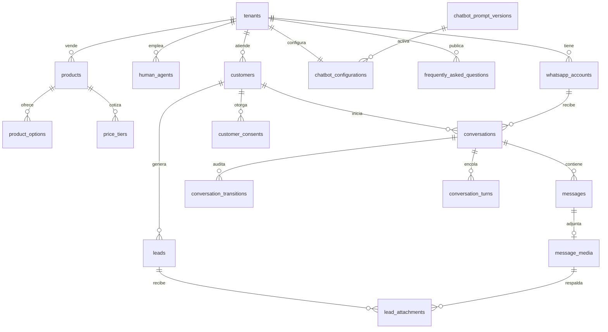

# Etapa 3: Diseño de base de datos

Estado: borrador para validar. Fecha: 2026-11-10. El SQL completo está en [V1__esquema_inicial.sql](../backend/src/main/resources/db/migration/V1__esquema_inicial.sql).

## Qué define esta etapa y por qué

Esta etapa traduce los requerimientos a tablas, relaciones e índices. Las garantías más delicadas quedan en la base y no solo en Java, porque ahí se cumplen aunque haya varias instancias o un error de programación.

Se relaciona con el resto así: el SQL será la primera migración de Flyway (Etapa 4), las colas sostienen el flujo de mensajes (Etapas 5 y 7) y las tablas de catálogo alimentan las herramientas de la IA (Etapa 6).

## 1. Modelo principal

## 2. Tablas

Las siete tablas que pediste están incluidas (`customers`, `conversations`, `messages`, `chatbot_configurations`, `frequently_asked_questions`, `human_agents`, `leads`). Las demás cubren lo detectado en las etapas anteriores.

| Grupo | Tabla | Propósito |
|---|---|---|
| Empresa | `tenants` | Empresa, zona horaria, idioma y moneda |
| | `whatsapp_accounts` | Número de WhatsApp y token cifrado |
| | `human_agents` | Administradores y operadores |
| Clientes | `customers` | Identidad, datos, baja y anonimización |
| | `customer_consents` | Evidencia de consentimiento; solo agrega filas |
| | `customer_interests` | Intereses y necesidades detectados |
| Configuración | `chatbot_configurations` | Ajustes vigentes y activación del bot |
| | `chatbot_prompt_versions` | Historial del prompt, con vuelta atrás |
| | `frequently_asked_questions` | FAQs con búsqueda en español |
| Catálogo | `products` | Productos o servicios |
| | `product_options` | Talle, color, tela, tamaño de diseño |
| | `price_tiers` | Precio de la prenda y adicional por tamaño de diseño, con vigencia |
| Conversación | `conversations` | Estado, operador asignado, ventana de 24 h |
| | `messages` | Mensajes y estado de entrega |
| | `message_media` | Archivos recibidos |
| | `conversation_transitions` | Auditoría de derivaciones y retornos |
| Colas | `webhook_events` | Eventos crudos de Meta |
| | `conversation_turns` | Trabajo pendiente de la IA |
| Métricas | `assistant_runs` | Tokens, costo y resultado, sin datos personales |
| Ventas | `leads` | Oportunidad, presupuesto y estado |
| | `lead_attachments` | Diseños y su revisión |

## 3. Decisiones

| # | Decisión | Por qué |
|---|---|---|
| D-1 | UUID v7 generados por la aplicación | No exponen ids secuenciales en el panel y se indexan mejor que los UUID aleatorios. |
| D-2 | Claves foráneas compuestas con `tenant_id` | La base impide relacionar filas de empresas distintas, aunque falle el filtro de Hibernate. |
| D-3 | Estados como `text` con `CHECK` | Agregar un valor es una migración simple. |
| D-4 | Importes en `numeric` | Evita errores de redondeo con dinero. |
| D-5 | Precios con vigencia y sin edición destructiva | Con inflación cambian seguido, y cada presupuesto debe poder explicarse. |
| D-6 | Copia del presupuesto en `leads.quote_snapshot` | Un aumento posterior no altera lo que ya se le cotizó al cliente. |
| D-7 | Opciones genéricas por producto | Sirve para remeras y para otros rubros sin cambiar el esquema. |
| D-8 | BSUID y teléfono opcionales, con al menos uno presente | Cubre clientes con nombre de usuario sin perder a los identificados por número. |
| D-9 | Email de operador único global | El login no necesita pedir la empresa. |

Nombres, estados y valores quedan en inglés para ser consistentes con el código. Los textos que ve el cliente siguen en español.

## 4. Garantías aplicadas por la base

| Garantía | Mecanismo |
|---|---|
| No procesar dos veces un mensaje | `UNIQUE (tenant_id, wamid)` |
| Una conversación abierta por cliente y número | Índice único parcial `conversations_one_open_uq` |
| Agrupar ráfagas | Un turno `PENDING` por conversación, con `run_after` que se atrasa hasta un tope |
| Nunca dos respuestas simultáneas | Un turno `PROCESSING` por conversación |
| Un presupuesto no ambiguo | Restricción `EXCLUDE` sobre producto, opción, cantidad y vigencia |
| Sin mezcla de empresas | Claves foráneas compuestas |
| Estados coherentes | `CHECK`: por ejemplo, `WITH_AGENT` exige operador |
| Toma segura por varias instancias | `FOR UPDATE SKIP LOCKED` con lease |

## 5. Índices

Cada índice responde a una consulta conocida.

| Consulta | Índice |
|---|---|
| Bandeja del panel | `conversations_inbox_idx` |
| Historial para contexto y panel | `messages_history_idx` |
| Cierre por inactividad | `conversations_inactive_idx` |
| Toma de trabajos pendientes | `turns_claim_idx`, `webhook_events_claim_idx`, `messages_outbox_idx` |
| Recuperación de instancias caídas | `turns_lease_idx`, `webhook_events_lease_idx`, `messages_sending_idx` |
| Estadísticas por período | `messages_stats_idx`, `assistant_runs_stats_idx`, `transitions_stats_idx` |
| Embudo comercial | `leads_pipeline_idx` |
| Búsqueda de FAQs | `faq_search_idx` (GIN) |

Las estadísticas se calculan con consultas directas. Si el volumen crece, se agregan tablas resumen y particionado de `messages` por mes.

## 6. Datos personales y retención

| Dato | Tratamiento |
|---|---|
| Pedido de borrado | Se borran conversaciones (y en cascada mensajes, adjuntos, transiciones y turnos), leads e intereses. El cliente queda sin datos, con `anonymized_at`. |
| Consentimiento | Se conserva como evidencia, sin vínculo al mensaje borrado. |
| Costos de IA | Se conservan sin referencia a la conversación. |
| Archivos | La aplicación elimina el archivo físico antes de borrar la fila. |
| Mensajes | Se purgan según `message_retention_days`. |
| `webhook_events` | Contienen datos personales: purga periódica, propuesta de 30 días. |

## 7. Verificación

El esquema se ejecutó completo sobre PostgreSQL 18.6 embebido y pasó 52 comprobaciones: aislamiento entre empresas, idempotencia, turnos, superposición y cálculo de precios, búsqueda de FAQs y borrado en cascada.

Queda para la Etapa 9: concurrencia real con varias conexiones, porque el motor embebido usa una sola, y rendimiento de los índices con volumen.

## 8. Reglas confirmadas

1. **Precio unitario:** precio base más la suma de cada estampa según su tamaño, más el adicional de talle especial si corresponde. El precio base es la fila sin `option_id`. Los tamaños son opciones `DESIGN_SIZE`, con sus medidas en `attributes`, y los talles con recargo son opciones `SIZE` con su propia fila de precio.
2. **Descuento mayorista:** es una segunda escala del precio base. En la remera: de 1 a 5 unidades $14.900, desde 6 unidades $13.410.
3. **Operadores:** cada uno trabaja para una sola empresa.
4. **Eventos crudos:** se purgan a los 30 días.

A confirmar: qué talles llevan recargo y cómo redondea la web el descuento. Ninguno de los dos cambia el esquema.
